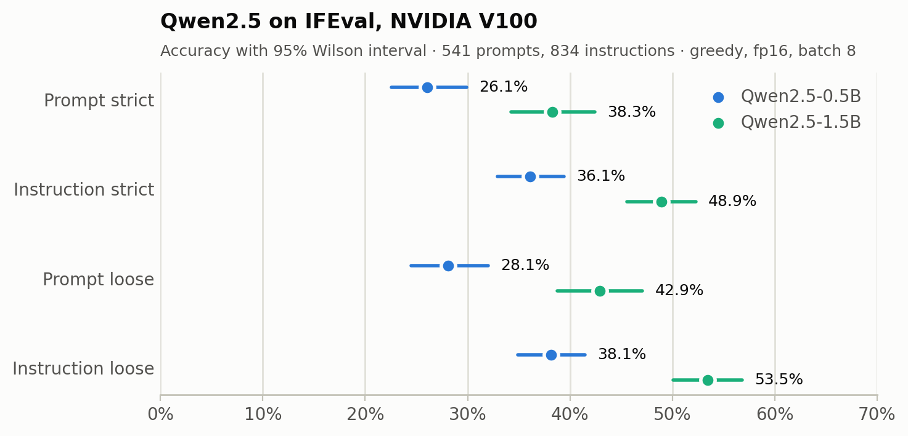
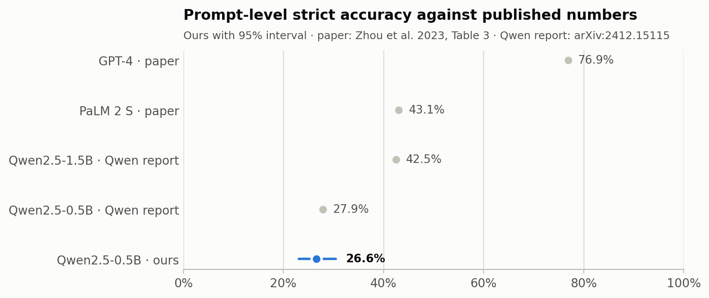
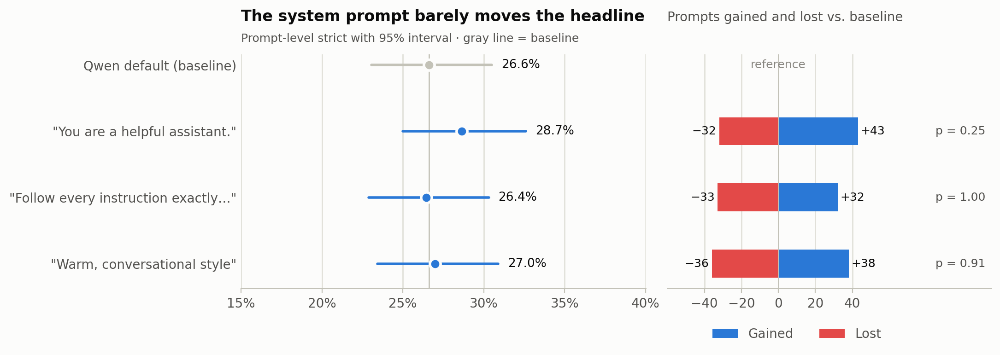
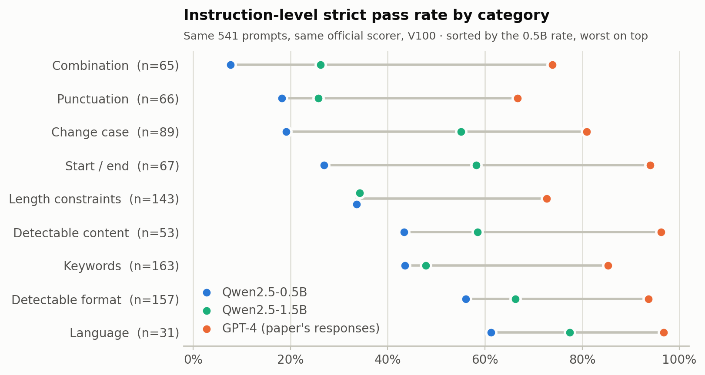
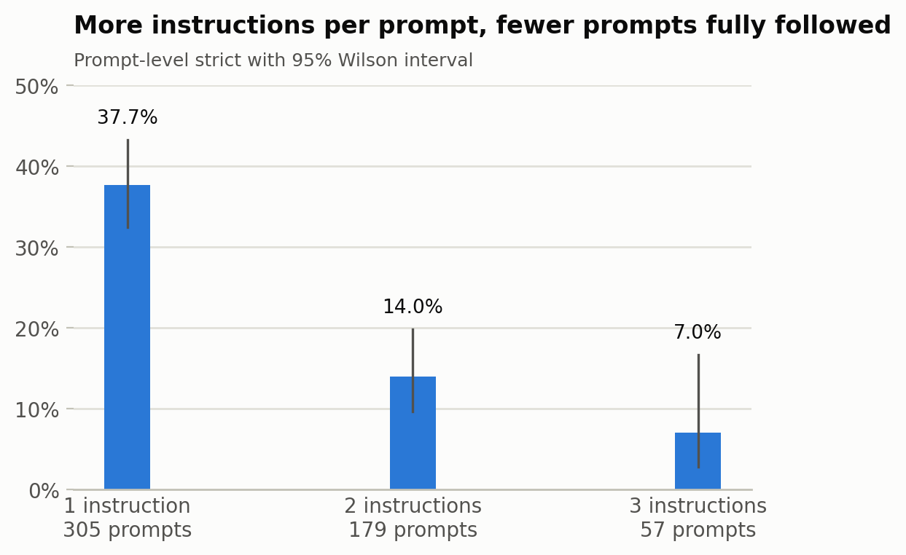
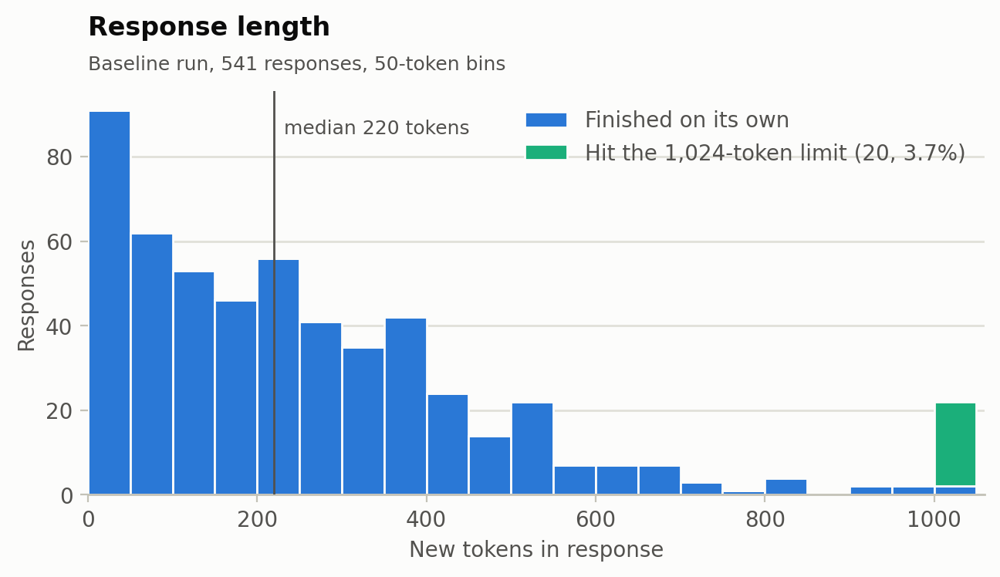
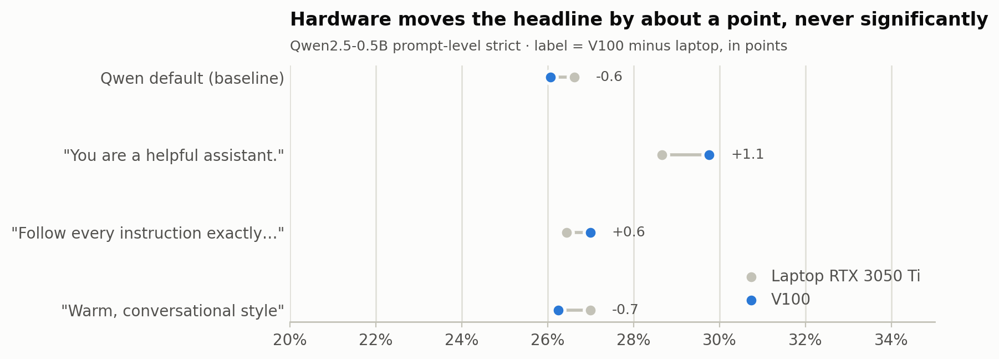
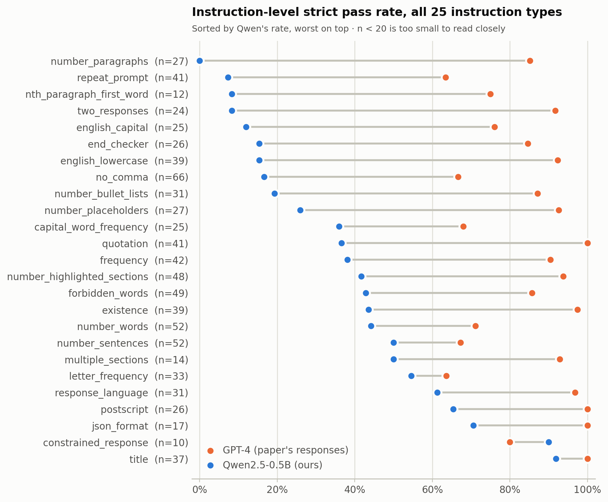

# How Well Do Small Models Follow Instructions?

**Evaluating Qwen2.5-0.5B and 1.5B on IFEval, and reading the gap to the paper**

Class project · Module 3: Evaluation · October 2026

---

## At a glance

| | |
|---|---|
| **Models** | Qwen2.5-0.5B-Instruct (commit `7ae5576`), Qwen2.5-1.5B-Instruct (commit `989aa79`) |
| **Benchmark** | IFEval: 541 prompts, 834 verifiable instructions |
| **Scorer** | Official Google scorer, unmodified (commit `ff4d1a6`) |
| **Hardware** | NVIDIA Tesla V100-SXM2-32GB (department DGX), fp16, batch 8 |
| **Headline** | **0.5B: 26.1%** of prompts fully followed (strict), 95% CI 22.5–29.9%<br>**1.5B: 38.3%**, 95% CI 34.3–42.4% |
| **vs. model developer** | Qwen reports 27.9% for 0.5B (**inside our interval**) and 42.5% for 1.5B (just above our strict interval, inside our loose one) |
| **vs. IFEval paper** | GPT-4 76.9%, PaLM 2 S 43.1% |
| **Harness check** | Re-scoring the paper's GPT-4 responses reproduces its strict numbers to within 0.2 points |
| **Repeatability** | 3 repeats per model on the V100 produced **byte-identical** generations |
| **Hardware effect** | Laptop → V100 moved the headline by −0.7 to +1.1 points, **none significant** |
| **System prompt** | 3 variants moved the headline by +0.2 to +3.7 points; **none significant** after correcting for 3 tests |
| **Scale** | 0.5B → 1.5B: **+12.2 points** (p < 0.001) |
| **Cost** | 30–37 min per run on the V100; 9 runs in 5 h 8 min |

---

## 1. What we set out to do

IFEval measures whether a model follows instructions that a program can check,
such as *"answer in all lowercase"*, *"use no commas"* or *"write exactly 3 paragraphs"*.
Because every instruction is checked by code, not by a human or another model,
the score is objective and repeatable.

We built an **evaluation harness** that a stranger can re-run with one command,
used it to measure two small open-weight models on the specified hardware, and
compared the results with published numbers.

> **Important framing:** the IFEval paper (Zhou et al., 2023) evaluated GPT-4 and
> PaLM 2 S, not Qwen. So this is **not a reproduction** of a paper number. It is a
> measurement of different, much smaller models on the same instrument. The one
> thing we *can* reproduce is the scorer, and we did (Section 3).

---

## 2. Method

### Pipeline

```
IFEval prompts (541)
  → build_prompts.py   apply the chat template, save the exact string sent
  → generate.py        model writes one response per prompt       [GPU]
  → score.py           official scorer → pass/fail per instruction
  → analyze.py         4 metrics + 95% CI, per-type, length, truncation
```

One command runs everything and writes a new timestamped folder under `runs/`.
Nothing is ever overwritten.

### The four metrics

| Metric | A prompt / instruction counts as passed when… |
|---|---|
| **Prompt-level strict** | *every* instruction in the prompt passes, checked on the raw response |
| **Instruction-level strict** | each instruction is counted separately |
| **Prompt-level loose** | as strict, but the scorer also tries lightly cleaned versions of the response (e.g. markdown `*` removed, first/last line dropped) |
| **Instruction-level loose** | loose, counted per instruction |

### Settings used

| Setting | Value | Why it matters |
|---|---|---|
| Model revisions | 0.5B `7ae557604adf…`, 1.5B `989aa7980e4c…` (pinned) | "main" can change under us |
| Precision / attention | fp16 / SDPA | the V100 has no bf16 or FlashAttention-2 |
| Decoding | greedy, `max_new_tokens = 1024` | deterministic baseline |
| Hidden decoding defaults | `repetition_penalty = 1.1`, `top_k = 20` | come from the model's own `generation_config.json` (only the penalty affects greedy) |
| Prompt format | model's chat template, empty system prompt | the template inserts Qwen's default system message (see below) |
| Batch size | 8 | as specified |
| Hardware | Tesla V100-SXM2-32GB, compute capability 7.0 (department DGX, GPU 1) | the specified hardware |
| Software | torch 2.4.1 built for CUDA 11.8, transformers 4.44.2, Python 3.10.14 | the server's driver only supports CUDA 11.0 (Section 8) |

The exact string the model received for the first prompt:

```
<|im_start|>system
You are Qwen, created by Alibaba Cloud. You are a helpful assistant.<|im_end|>
<|im_start|>user
Write a 300+ word summary of the wikipedia page "…Raymond_III,_Count_of_Tripoli".
Do not use any commas and highlight at least 3 sections …<|im_end|>
<|im_start|>assistant
```

---

## 3. Validating the instrument before trusting it

A score is only meaningful if the measuring tool is correct. We ran three checks.

### Check 1: The scorer reproduces the paper

The scorer repository ships the GPT-4 responses used in the paper. We scored them
with our pinned scorer seven times:

| GPT-4 | Prompt strict | Instr. strict | Prompt loose | Instr. loose |
|---|---|---|---|---|
| **Paper (Table 3)** | 76.89 | 83.57 | 79.30 | 85.37 |
| **Our scorer** (7 scorings) | **76.89**–77.08 | **83.57**–83.69 | 79.48–79.67 | 85.49–85.61 |

- **Strict: exact match** in 6 of 7 scorings; the seventh is 0.2 points higher.
- **Loose: 0.2–0.4 points higher** than the paper in every scoring. This is an
  unexplained residual. Likely candidates are changes to the scorer's loose
  mode since 2023 and the prompt edit described below. It is too small to affect
  any conclusion here.

The GPT-4 columns elsewhere in this report come from one cached scoring
(`reference/gpt4_paper/`), which happens to be one of the 77.08 / 83.69 kind.

### Check 2: Two issues found in the official benchmark (documented, not patched)

1. **The scorer is not fully deterministic.** Two prompts (keys 1122 and 1129) ask
   how often the characters `#` and `!` appear. The `letter_frequency` checker
   rejects non-letters and silently substitutes a **random letter** each time it
   runs. The same responses can therefore score differently.
   *Measured:* the three V100 runs of each model produced byte-identical text, yet
   the 0.5B instruction-level strict score came out 300, 301 and 302 of 834
   (a 0.24-point spread), and the 1.5B **prompt-level** strict score came out 207,
   206 and 206 of 541 (0.18 points).
2. **The benchmark file changed after the paper.** Prompt 2785 now asks for
   "at least **3** placeholders"; the paper's GPT-4 answers were written for
   "at least **one** placeholder". The paper's response file no longer scores
   without adjustment (we remapped that one prompt for Check 1).

### Check 3: The pipeline runs end-to-end without a model

A "dummy" mode that returns canned text runs the full pipeline on any laptop
in about 3 seconds and scores above zero, which proves the scorer is wired
correctly before spending GPU time. A preflight script then checks the GPU node
itself (GPU model, Python version, data, pinned revision) before each real run.

---

## 4. Results

### Headline metrics (V100)

| Metric | Qwen2.5-0.5B | 95% CI | Qwen2.5-1.5B | 95% CI |
|---|---|---|---|---|
| **Prompt-level strict** | **26.1%** | 22.5 – 29.9% | **38.3%** | 34.3 – 42.4% |
| Instruction-level strict | 36.1% | 32.9 – 39.4% | 48.9% | 45.5 – 52.3% |
| Prompt-level loose | 28.1% | 24.5 – 32.0% | 42.9% | 38.8 – 47.1% |
| Instruction-level loose | 38.1% | 34.9 – 41.5% | 53.5% | 50.1 – 56.8% |

*n = 541 prompts and 834 instructions for every metric.*



**Run-to-run spread:** each model was run 3 times on the V100 with identical
settings, and all 3 runs produced byte-identical generations. Prompt-level
strict across the repeats, as mean [min–max]:

| Model | Prompt-level strict across 3 repeats | Spread |
|---|---|---|
| Qwen2.5-0.5B | 26.06% [26.06–26.06] | **0.00 points** |
| Qwen2.5-1.5B | 38.14% [38.08–38.26] | 0.18 points |

So run-to-run spread for the 0.5B headline was **0.0 points** on this hardware at
batch 8. Every remaining difference between repeats (0.24 points instruction-level
for 0.5B, 0.18 points prompt-level for 1.5B) comes from the scorer's random letter
check (Section 3), not from the model. *Computed by `src/aggregate_runs.py`.*

### Comparison with published numbers (prompt-level strict)

| Model | Size | Prompt-level strict | Source |
|---|---|---|---|
| GPT-4 | undisclosed | 76.9% | IFEval paper, Table 3 |
| PaLM 2 S | undisclosed | 43.1% | IFEval paper, Table 3 |
| Qwen2.5-1.5B-Instruct | 1.5B | 42.5% | Qwen2.5 Technical Report* |
| **Qwen2.5-1.5B-Instruct (ours)** | **1.5B** | **38.3%** (34.3–42.4) | this harness, V100 |
| Qwen2.5-0.5B-Instruct | 0.5B | 27.9% | Qwen2.5 Technical Report* |
| **Qwen2.5-0.5B-Instruct (ours)** | **0.5B** | **26.1%** (22.5–29.9) | this harness, V100 |

\* The report lists a single IFEval figure without saying which of the four
metrics it is. For 0.5B, 27.9 lies inside our interval for both prompt-level
metrics. For 1.5B, 42.5 lies just above our strict interval (upper bound 42.4)
and inside our loose one (38.8–47.1), so that comparison depends on the metric.



**Gaps for 0.5B:** −50.8 points to GPT-4, −17.0 to PaLM 2 S, −1.8 to Qwen's own report.
**Gaps for 1.5B:** −38.6 points to GPT-4, −4.8 to PaLM 2 S, −4.2 to Qwen's own report.

### Scale: 0.5B → 1.5B

Same prompts, same settings, same GPU; only the model changed.

| Metric | 0.5B | 1.5B | Change |
|---|---|---|---|
| Prompt-level strict | 26.1% | 38.3% | **+12.2 points** |
| Instruction-level strict | 36.1% | 48.9% | +12.8 points |
| Prompt-level loose | 28.1% | 42.9% | +14.8 points |
| Instruction-level loose | 38.1% | 53.5% | +15.3 points |

- **Paired by prompt:** 105 prompts that the 0.5B model failed are passed by
  1.5B, and 39 go the other way (exact McNemar test, p < 0.001).
- **The gains are uneven.** Change case rises from 19.1% to 55.1% and start/end
  from 26.9% to 58.2%, but length constraints barely move (33.6% → 34.3%).
- **Three times the parameters closes 12 of the 17 points** between 0.5B and
  PaLM 2 S.

### Sensitivity to the system prompt (V100)

With an empty system prompt, Qwen's chat template inserts its own default
(*"You are Qwen, created by Alibaba Cloud. You are a helpful assistant."*).
We replaced it with three alternatives on the 0.5B model and changed nothing else.

| System prompt | Prompt strict | Instr. strict | Prompt loose | Instr. loose | Truncated | Prompts gained / lost | p |
|---|---|---|---|---|---|---|---|
| Qwen default (baseline) | 26.1% | 36.1% | 28.1% | 38.1% | 3.7% | — | — |
| "You are a helpful assistant." | 29.8% | 40.8% | 32.7% | 43.8% | 6.3% | +49 / −29 | 0.03 |
| "…Follow every instruction … exactly, including all formatting, length, casing and punctuation requirements." | 27.0% | 37.8% | 29.9% | 41.5% | 4.1% | +36 / −31 | 0.63 |
| "…writes in a warm, natural, conversational style." | 26.2% | 36.1% | 29.0% | 39.1% | 4.8% | +38 / −37 | 1.00 |



*Gained / lost: prompts that failed in the baseline and passed with the variant,
and the reverse (prompt-level strict). p: exact McNemar test on those paired
prompts. With three variants tested, the Bonferroni-corrected threshold is
0.05 / 3 ≈ 0.017.*

- **Changing the system prompt rewrote almost every response.** Only 9–17 of
  541 responses stayed identical to the baseline, and 67–78 prompts changed
  outcome.
- **The headline barely moved.** Gains and losses nearly cancel: the net effect
  on prompt-level strict ranges from +0.2 to +3.7 points.
- **The generic prompt gave the largest gain** (+3.7 points). Its p = 0.03 clears
  0.05 but not the corrected 0.017, so we report it as suggestive, not
  established. It points the same way on the laptop (+2.0 points, p = 0.25).
  It also raised truncation from 3.7% to 6.3%.
- **Telling the model to follow instructions did not reliably help** (+0.9 points
  on the V100, −0.2 on the laptop).

---

## 5. Where the model fails

### By instruction category (instruction-level strict, V100)

| Category | Qwen 0.5B | Qwen 1.5B | GPT-4 | n |
|---|---|---|---|---|
| Language (`response_language`) | 61.3% | 77.4% | 96.8% | 31 |
| Detectable format (JSON, title, bullets…) | 56.1% | 66.2% | 93.6% | 157 |
| Keywords (include / avoid / frequency) | 43.6% | 47.9% | 85.3% | 163 |
| Detectable content (postscript, placeholders) | 43.4% | 58.5% | 96.2% | 53 |
| Length constraints (words, sentences, paragraphs) | 33.6% | 34.3% | 72.7% | 143 |
| Start / end (quotation, end phrase) | 26.9% | 58.2% | 94.0% | 67 |
| Change case (all caps / all lowercase) | 19.1% | 55.1% | 80.9% | 89 |
| Punctuation (no commas) | 18.2% | 25.8% | 66.7% | 66 |
| Combination (repeat prompt, two responses) | 7.7% | 26.2% | 73.8% | 65 |



*GPT-4 column: the paper's published responses, scored by our harness.*

### The five hardest and five easiest instruction types (0.5B)

| Hardest | Pass | | Easiest | Pass |
|---|---|---|---|---|
| `number_paragraphs` | 0 / 27 | | `constrained_response` | 9 / 10 |
| `repeat_prompt` | 3 / 41 | | `title` | 33 / 37 |
| `english_capital` | 2 / 25 | | `json_format` | 12 / 17 |
| `two_responses` | 2 / 24 | | `postscript` | 16 / 26 |
| `nth_paragraph_first_word` | 1 / 12 | | `response_language` | 19 / 31 |

### What the failures look like (0.5B)

| Instruction | What was asked | What the model did |
|---|---|---|
| **Paragraphs** (0%) | "Separate the paragraphs with the markdown divider `***`" | Used blank lines instead: only 4 of 27 responses contained `***` at all |
| **Two responses** (8%) | "Give two responses separated by `******`" | Wrote a numbered list `1. … 2. …` |
| **Repeat prompt** (7%) | "First repeat the request word for word, then answer" | Skipped the repetition and answered directly |
| **All lowercase** (15%) | "Write a letter … in all lowercase letters" | Opened with `Dear [Friend's Name],`, using normal capitalisation |
| **No commas** (18%) | "Do not use any commas" | Used commas from the first line |

**Pattern:** the model does the *task* (writes the letter, the story, the email)
but ignores the *formatting constraint* attached to it. Constraints that match
common writing habits (titles, JSON, postscripts) pass; constraints that fight
habits (no capitals, no commas, unusual separators) fail. The 1.5B model fixes
much of the casing and start/end failures, but not length constraints.

### More instructions → much lower success

| Instructions in the prompt | Prompts | 0.5B fully followed | 1.5B fully followed |
|---|---|---|---|
| 1 | 305 | 111 (36.4%) | 166 (54.4%) |
| 2 | 179 | 26 (14.5%) | 36 (20.1%) |
| 3 | 57 | 4 (7.0%) | 5 (8.8%) |



This is why prompt-level accuracy sits well below instruction-level accuracy for
both models. Most of the 1.5B gain comes from single-instruction prompts.

---

## 6. Response length and truncation (0.5B, V100)

| | |
|---|---|
| Median length | 215 tokens |
| 90th percentile | 559 tokens |
| Hit the 1024-token limit | **20 responses (3.7%)** |
| Truncated responses that still passed | 9 of 20 |
| Truncated responses stuck in a repetition loop | ~8 of 20 (last lines repeat) |



**Upper bound on the truncation effect:** even if all 11 failing truncated
responses had passed, prompt-level strict would rise by at most **2.0 points**
(to 28.1%). Truncation does not explain the gap to PaLM 2 S or GPT-4. The 1.5B
model truncates less: 12 responses (2.2%), median 198 tokens.

---

## 7. Reading the gap

**Against Qwen's own report: no meaningful gap for 0.5B, a small one for 1.5B.**
For 0.5B, their 27.9% lies inside our 95% interval (±3.7 points), so our harness
agrees with the model developer. For 1.5B, their 42.5% is 4.2 points above our
strict score and just outside its interval, but inside our loose interval.
Qwen does not say which metric it reports, so this residual cannot be pinned down
further. System prompt and decoding settings could each contribute.

**Against PaLM 2 S (−17.0) and GPT-4 (−50.8): a real capability gap, dominated by scale.**
These are different, far larger models, so the gap is not a harness error: the
same scorer reproduces GPT-4's strict numbers to within 0.2 points. Within one
model family, tripling the parameters already closes 12.2 points of the 17-point
gap to PaLM 2 S. Known confounds, and how large each can be:

| Confound | Direction | Size (measured or bounded) |
|---|---|---|
| Model scale | lowers ours | **+12.2 points** from 0.5B to 1.5B alone (measured) |
| Truncation at 1024 tokens | lowers ours | **≤ 2.0 points** (bounded above) |
| Scorer randomness (`letter_frequency` bug) | either | **≤ 0.24 points** instruction-level, **≤ 0.18** prompt-level (observed on identical text) |
| Benchmark edit (prompt 2785) | either | ≤ 0.18 points (1 prompt in 541) |
| Default system prompt inserted by template | either | **+0.2 to +3.7 points** across 3 variants, none significant after correction (Section 4) |
| Run-to-run variation (same hardware and settings) | none | **0**: 3 repeats per model gave byte-identical generations |
| Hardware: laptop GPU, batch 4, CUDA 12.1 vs. V100, batch 8, CUDA 11.8 | either | **−0.7 to +1.1 points** across 4 configurations, none significant (Section 8) |
| `repetition_penalty = 1.1` from model defaults | unknown | not varied (Section 8) |

**Honest bottom line:** even added together, the confounds other than scale
(truncation ≤ 2.0, system prompt ≤ 3.7, hardware ≤ 1.1, scorer and benchmark
≤ 0.4) stay under 8 points, well short of the 17- and 51-point gaps. Scale, by
contrast, moves the score 12 points on its own. That is consistent with the steep
drop on prompts that stack several instructions, and with the models ignoring
format constraints while still completing the task.

---

## 8. Hardware and limitations

### The specified hardware

All primary results come from the specified hardware: an NVIDIA Tesla
V100-SXM2-32GB (compute capability 7.0) in the department DGX, GPU 1, with fp16,
SDPA attention and batch size 8. Two adjustments were forced by the server, and
both are recorded in every run's `run_manifest.json`:

- **CUDA 11.8 build of torch.** The server's NVIDIA driver (450.119.03) supports
  CUDA 11.0, and the default torch 2.4.1 wheel is built for CUDA 12.1, so it could
  not see the GPU. We used the CUDA 11.8 build of the same torch version, which
  runs on this driver through NVIDIA's minor-version compatibility. The torch
  version is unchanged; its CUDA math libraries are not.
- **Python 3.10.14 instead of the server's 3.8.** The official scorer annotates
  fields as `list[str]`, which Python 3.8 cannot load, so every run would have
  crashed at scoring. We installed the same Python the laptop uses.

The harness's preflight check now catches both problems before a run starts.

### What the laptop runs add

Before the V100 was available, the same configurations ran on a 4 GB laptop
GPU (RTX 3050 Ti, batch 4, CUDA 12.1). That gives a direct hardware comparison:

| Configuration | Laptop | V100 | Change | Prompts gained / lost | p | Identical responses |
|---|---|---|---|---|---|---|
| Qwen default (baseline) | 26.6% | 26.1% | −0.55 | +1 / −4 | 0.38 | 349 / 541 |
| "You are a helpful assistant." | 28.7% | 29.8% | +1.11 | +12 / −6 | 0.24 | 343 / 541 |
| "Follow every instruction exactly…" | 26.4% | 27.0% | +0.55 | +5 / −2 | 0.45 | 341 / 541 |
| "Warm, conversational style" | 27.0% | 26.2% | −0.74 | +2 / −6 | 0.29 | 340 / 541 |



- **The hardware changes the text more than the score.** 35–37% of responses
  differ word-for-word between laptop and V100, yet prompt-level outcomes moved by
  at most 1.1 points, and no difference is significant.
- **The three changes cannot be separated.** GPU architecture, batch size and CUDA
  runtime all changed together, so this measures their combined effect only.
- **Within each machine, results are exactly repeatable.** Four laptop runs and
  three V100 runs each produced byte-identical generations.

### Cost

On the V100, a 0.5B run took 30–35 minutes and a 1.5B run 36–37 minutes; the 9
runs took 5 hours 8 minutes. That is *slower* than the laptop's 17–19 minutes for
a 0.5B run. The likely causes are that the DGX is shared and was heavily loaded
(load average about 10 at login), and that generating with a model this small is
limited by per-token CPU overhead rather than GPU speed. We did not measure
either cause, so the "GPU-hours" figures overstate the GPU work actually done.

### Other limitations

- **Confidence intervals assume independence.** Instructions inside one prompt
  are correlated, so the instruction-level interval is somewhat too narrow.
- **Decoding defaults used as shipped.** `repetition_penalty = 1.1` from the
  models' own generation configs applied to every run and was not varied.
- **Qwen's reported metric is unknown.** That limits how precisely the 1.5B
  comparison can be read.
- **Version control.** Every V100 run records commit `14def94` with no
  uncommitted files; only the first laptop run predates version control.

**Further work:** saving generations after each batch would let an interrupted
run resume, and the optional template ablation (`template_mode: raw`) was not
run. Neither was implemented or measured here.

---

## 9. Reproducing this result

On the department DGX (book a GPU, SSH in, work inside `tmux`):

```bash
curl -LsSf https://astral.sh/uv/install.sh | sh && export PATH="$HOME/.local/bin:$PATH"
git clone https://github.com/runjanna26/module_3_evaluation.git && cd module_3_evaluation
uv venv --python 3.10.14 --seed .venv
.venv/bin/pip install -r requirements.txt
# only on a CUDA 11 driver, like this DGX:
.venv/bin/pip uninstall -y torch
.venv/bin/pip install torch==2.4.1 --index-url https://download.pytorch.org/whl/cu118
./scripts/setup.sh
./scripts/run_schedule.sh 1        # 1 = the booked GPU; 9 runs, about 5 hours
```

Every chart above is regenerated from `runs/` by
`report/evaluation_figures.ipynb` (`pip install -r requirements-notebook.txt`),
which writes `report/figures/*.png`. `scripts/make_pdf.py` renders this report
to PDF.

Every run behind this report has its own directory under `runs/`:

| Run directory | Role |
|---|---|
| `qwen05b_hf_20261020_123355_IST-DGX02-gpu1-1` | **0.5B baseline, V100** (all 0.5B figures unless stated) |
| `qwen05b_hf_…_130713_…-2`, `…_133753_…-3` | 0.5B repeats, V100 |
| `qwen05b_sys_{generic,strict,casual}_hf_…_IST-DGX02-gpu1-{4,5,6}` | system-prompt variants, V100 |
| `qwen15b_hf_20261020_155056_IST-DGX02-gpu1-7` | **1.5B, V100** (all 1.5B figures) |
| `qwen15b_hf_…_162815_…-8`, `…_170516_…-9` | 1.5B repeats, V100 |
| `qwen05b_laptop_hf_20260916_004530` and 3 repeats | 0.5B on the laptop (hardware comparison) |
| `qwen05b_laptop_sys_{generic,strict,casual}_hf_…` | system-prompt variants on the laptop |
| `qwen05b_hf_20260916_003724` | failed laptop attempt, batch 8, out of memory (kept as a record) |

Each directory contains:

| File | Contents |
|---|---|
| `config.yaml`, `environment.txt`, `run_manifest.json` | every setting, the GPU, library versions and the resolved model commit |
| `sample_prompt.txt`, `prompts_rendered.jsonl` | exact strings sent to the model |
| `generations.jsonl` | all 541 raw responses, verbatim |
| `eval_results_strict.jsonl`, `eval_results_loose.jsonl` | official per-item scores |
| `report.json` | the metrics for that run |

---

## Appendix: all 25 instruction types (instruction-level strict, V100)

| Instruction type | Qwen 0.5B | Passed / n | Qwen 1.5B | GPT-4 |
|---|---|---|---|---|
| `length_constraints:number_paragraphs` | 0.0% | 0 / 27 | 14.8% | 85.2% |
| `combination:repeat_prompt` | 7.3% | 3 / 41 | 14.6% | 63.4% |
| `change_case:english_capital` | 8.0% | 2 / 25 | 40.0% | 76.0% |
| `combination:two_responses` | 8.3% | 2 / 24 | 45.8% | 91.7% |
| `length_constraints:nth_paragraph_first_word` | 8.3% | 1 / 12 | 8.3% | 75.0% |
| `change_case:english_lowercase` | 15.4% | 6 / 39 | 64.1% | 92.3% |
| `startend:end_checker` | 15.4% | 4 / 26 | 61.5% | 84.6% |
| `punctuation:no_comma` | 18.2% | 12 / 66 | 25.8% | 66.7% |
| `detectable_format:number_bullet_lists` | 19.4% | 6 / 31 | 48.4% | 87.1% |
| `detectable_content:number_placeholders` | 25.9% | 7 / 27 | 29.6% | 92.6% |
| `startend:quotation` | 34.1% | 14 / 41 | 56.1% | 100.0% |
| `change_case:capital_word_frequency` | 36.0% | 9 / 25 | 56.0% | 68.0% |
| `keywords:frequency` | 38.1% | 16 / 42 | 33.3% | 90.5% |
| `detectable_format:number_highlighted_sections` | 41.7% | 20 / 48 | 52.1% | 93.8% |
| `length_constraints:number_words` | 42.3% | 22 / 52 | 40.4% | 71.2% |
| `keywords:forbidden_words` | 42.9% | 21 / 49 | 51.0% | 85.7% |
| `keywords:existence` | 43.6% | 17 / 39 | 56.4% | 97.4% |
| `length_constraints:number_sentences` | 48.1% | 25 / 52 | 44.2% | 67.3% |
| `keywords:letter_frequency` † | 51.5% | 17 / 33 | 51.5% | 63.6% |
| `detectable_format:multiple_sections` | 57.1% | 8 / 14 | 71.4% | 92.9% |
| `language:response_language` | 61.3% | 19 / 31 | 77.4% | 96.8% |
| `detectable_content:postscript` | 61.5% | 16 / 26 | 88.5% | 100.0% |
| `detectable_format:json_format` | 70.6% | 12 / 17 | 76.5% | 100.0% |
| `detectable_format:title` | 89.2% | 33 / 37 | 83.8% | 100.0% |
| `detectable_format:constrained_response` | 90.0% | 9 / 10 | 100.0% | 80.0% |



† Contains the two randomly-scored items described in Section 3. For example,
another scoring of the same GPT-4 responses gives 60.6% here instead of 63.6%.
Small-n types (n < 20) should not be over-interpreted.

**References**

- Zhou et al. (2023). *Instruction-Following Evaluation for Large Language Models.* arXiv:2311.07911
- Qwen Team (2024). *Qwen2.5 Technical Report.* arXiv:2412.15115
